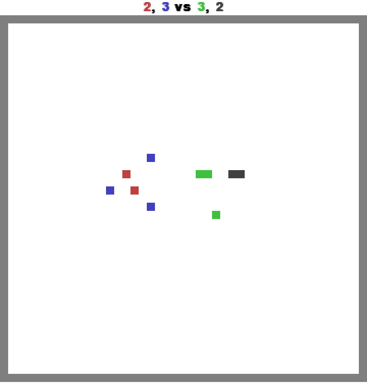
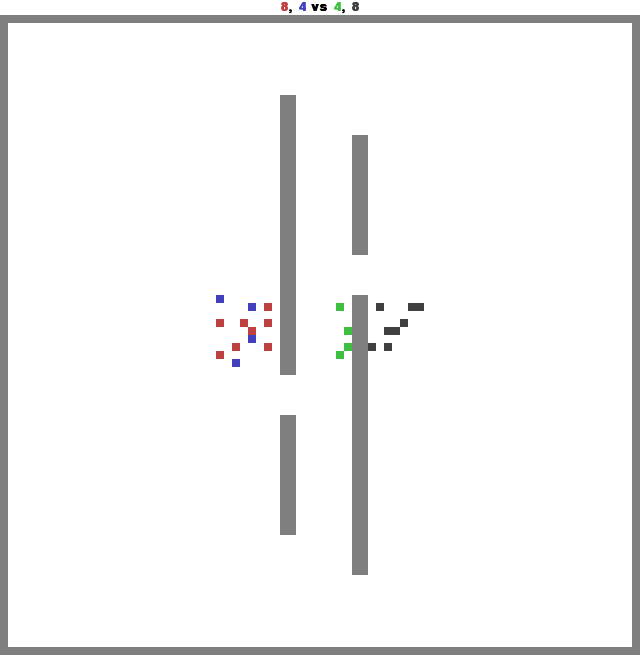
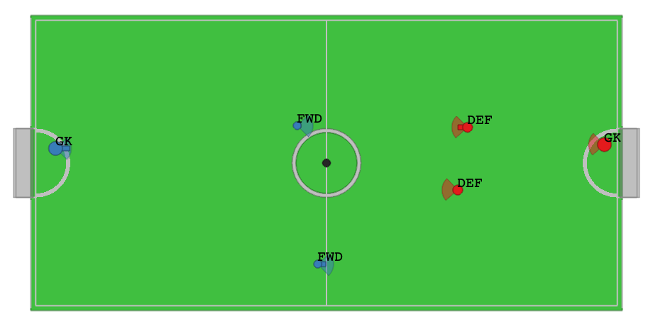

# Bilevel MARL Benchmark


Multi-agent environments for testing bilevel strategies. Every environment is a [PettingZoo `ParallelEnv`](https://pettingzoo.farama.org/api/parallel/).

## Environments

| Name | Based on | Changes |
|---|---|---|
| `combined_arms` | [MAgent2](https://magent2.farama.org/environments/combined_arms/) | Melee and ranged counts set per team |
| `battlefield` | [MAgent2](https://magent2.farama.org/environments/battlefield/) | Melee and ranged units, counts set per team |
| `football` | [VMAS](https://github.com/proroklab/VectorizedMultiAgentSimulator) | Player roles set per team |
| `capture_the_flag` | [Melting Pot](https://github.com/google-deepmind/meltingpot) via [Shimmy](https://shimmy.farama.org/environments/meltingpot/) | None |
| `king_of_the_hill` | [Melting Pot](https://github.com/google-deepmind/meltingpot) via [Shimmy](https://shimmy.farama.org/environments/meltingpot/) | None |

## Installation

```bash
git clone https://github.com/anuraagshankar/bilevel-marl-bench.git
cd bilevel-marl-bench
pip install -e ".[all]"
```

Replace `all` with `magent`, `vmas` or `meltingpot` to install a single backend.

## Usage

```python
from bilevel_marl_bench import make

env = make("combined_arms", render_mode="human")
obs, infos = env.reset(seed=0)
while env.agents:
    actions = {a: env.action_space(a).sample() for a in env.agents}
    obs, rewards, terminations, truncations, infos = env.step(actions)
env.close()
```

`render_mode`: `"human"` opens a window, `"rgb_array"` returns frames from `env.render()`, `None` (default) disables rendering.

### Combined arms

<p align="center">
  
</p>

```python
env = make("combined_arms", red_melee=2, red_ranged=3, blue_melee=3, blue_ranged=2)
```

Defaults are 45 melee and 36 ranged per team.

### Battlefield

<p align="center">
  
</p>

```python
env = make("battlefield", red_melee=8, red_ranged=4, blue_melee=4, blue_ranged=8)
```

Combined arms units on battlefield's walled map. Defaults are 6 melee and 6 ranged per team.

### Football

<p align="center">
  
</p>

```python
env = make("football", blue_roles={"gk": 1, "fwd": 2}, red_roles={"gk": 1, "def": 2})
```

Roles are `gk`, `def` and `fwd`. Defaults are one of each per team. Both teams are agents by default; pass `ai_blue_agents=True` or `ai_red_agents=True` to let VMAS's built-in AI control a team.

Players spawn by role: goalkeepers in the D, defenders in the middle third of their half, forwards in the third next to the centre line.

The fan in front of each player is its shooting zone: the player can shoot when the ball is inside it (the fan turns pink).

## Examples

```bash
python examples/random_rollout.py   # all environments
python examples/combined_arms.py    # combined arms with custom team composition
python examples/battlefield.py      # battlefield with custom team composition
python examples/football.py         # football with custom roles per team
```
